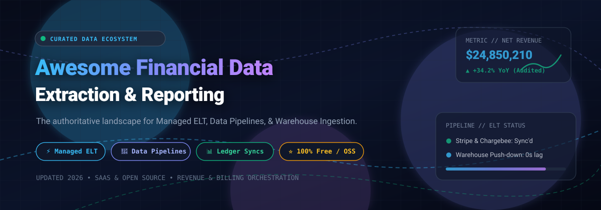

# 📊 Awesome Financial Data Extraction & Reporting

  

  
  
  
  
  

---

## 🚀 Overview & Ecosystem Scope

A curated directory and reference landscape of **SaaS platforms** and **open-source data engineering tools** designed for **Financial Data Extraction, ELT Pipelines, Ledger Synchronization, and Financial Reporting**. 

Whether you are extracting billing and payment transaction records from payment gateways (Stripe, Chargebee, Adyen), syncing ERP accounting data (NetSuite, QuickBooks), loading operational database logs into cloud data warehouses, or creating auditable financial models, this repository maps the best managed platforms and self-hosted tools available.

### 🎯 Key Focus Areas
- ⚡ **Managed Cloud ELT & Data Pipelines**: Zero-maintenance connectors for billing, SaaS, and financial ledger data.
- 🏢 **Warehouse-Native & Delta Sharing**: Secure, direct data sharing across institutions with zero egress penalties.
- 🛠️ **Open-Source Data Engineering Engines**: Self-hosted ingestion, orchestration, transformation, and validation tools eliminating volume-based vendor lock-in.
- 📈 **Financial Data Extraction & Reporting**: Specialized tooling for regulatory SEC filings, market quotes, ledger reconciliations, and executive dashboards.

---

## 📑 Table of Contents
- [🌐 Sector Overview & Market Dynamics](#-sector-overview--market-dynamics)
- [🏢 SaaS & Hosted Data Platforms](#-saas--hosted-data-platforms)
- [💻 Open-Source Data Pipelines & Extraction Tools](#-open-source-data-pipelines--extraction-tools)
- [🤝 How to Contribute](#-how-to-contribute)
- [💖 Support & Sponsorship](#-support--sponsorship)
- [📈 Star History](#-star-history)
- [⚖️ Disclaimer](#️-disclaimer)

---

## 🌐 Sector Overview & Market Dynamics

The global data integration and ELT market is estimated at **$15B–$19B** (growing at an ~11%–13% CAGR toward $33B+ by 2030), with Banking, Financial Services, and Insurance (BFSI) representing over **20%–25%** of overall industry spend driven by stringent auditability, compliance, and real-time reconciliation demands. 

The market exhibits a **hybrid concentration**:
- **Storage & Compute Layer**: Moderately concentrated among enterprise hyperscalers and cloud data warehouses/lakehouses (Google Cloud, Snowflake, Databricks).
- **Ingestion & Pipeline Tooling Layer**: **Moderately fragmented** across managed ELT vendors and an expanding ecosystem of open-source projects competing on connector depth, developer control, and per-row cost elimination rather than consolidating into a winner-take-all monopoly.

---

## 🏢 SaaS & Hosted Data Platforms

The following hosted platforms provide managed data extraction, automated schema migrations, and high-performance ingestion for financial workloads, sorted descending by enterprise valuation and revenue scale.

| Product | Valuation / Scale | Description | Pricing (Starting) | Free Tier / Trial Limits |
|:---|:---|:---|:---|:---|
| **[Google BigQuery Export](https://cloud.google.com/bigquery/)** | **~$3.6T+** (Parent: Alphabet Inc. Market Cap) | ☁️ Scalable cloud analytics engine with managed export workflows, serverless shared slots, and native SQL analytics. | On-demand query compute starts at **$6.25 per TiB** processed (batch exports up to 50 TiB/day are $0 compute) | **Always Free tier**: **10 GiB storage** and **1 TiB query analysis** per month forever. **90-day Google Cloud trial** with **$300 credits**. |
| **[Databricks OpenSharing](https://www.databricks.com/)** | **~$190B** (Private Valuation) | 🔗 **Open data sharing across platforms.** Open Delta Sharing protocol with zero egress costs for intra-region sharing. | Standard Jobs Compute: **$0.15/DBU-hour** (SQL Warehouse at ~$0.22/DBU-hour); sharing protocol included free | **14-day free trial** with **$400 in usage credits** (plus a permanent non-commercial **Free Edition** capped by daily fair-usage compute quotas). |
| **[Snowflake Data Sharing](https://www.snowflake.com/)** | **~$100B+** (NYSE: SNOW Market Cap) | ❄️ **Native data sharing without copying.** Direct, live data sharing where providers publish and consumers pay only for query compute. | Standard Edition: **$2.00 per credit** (e.g., X-Small warehouse at $2.00/hour compute); sharing feature included at no added software cost | **30-day free trial** with **$400 in complimentary usage credits**; no permanent free tier. |
| **[Segment](https://segment.com/)** | **~$32.7B** (Parent: Twilio Inc. Market Cap) | 🎯 Customer data platform with warehouse syncs that stream transaction events directly into Snowflake, Redshift, or BigQuery. | Team plan: Starts at **$120/month** (includes 10,000 MTUs and up to 1M reverse ETL records/month) | **Developer (Free) plan**: Free forever for up to **1,000 MTUs/month**, 2 sources, 1 warehouse destination, and 500k reverse ETL records. |
| **[Fivetran](https://www.fivetran.com/)** | **~$5.6B** (Valuation, ~$600M ARR post-merger) | 🔄 **The managed ELT benchmark.** 700+ connectors for billing systems, databases, and SaaS tools with automated schema sync. | Pay-as-you-go (Standard); $5 minimum per connection (1–1M MAR) | **Free plan**: Up to 500,000 MAR/month & 5,000 monthly transformation model runs free forever (no base charge). **14-day free trial** with unlimited syncs for paid plans. |
| **[Airbyte](https://airbyte.com/)** | **~$1.5B** (Valuation, ~$20M+ ARR) | 🛸 **Open-core data integration platform.** Cloud-managed ELT with pre-built connectors and custom connector development kits. | Standard: **$10/month** (includes 5 credits, $5/additional credit); Plus: **$189/month** (40 credits) | **Core (self-managed)**: Free forever with unlimited volume & connectors. **Free Cloud**: 5,000 credits/month permanently; **30-day free trial** for cloud tiers. |
| **[Matillion](https://www.matillion.com/)** | **~$1.5B** (Valuation, ~$100M ARR) | ⚡ Cloud-native ELT with push-down transformation capabilities into Snowflake, Databricks, Redshift, and BigQuery. | Developer tier: **$2.00/credit** consumption-based (approx. $2/task-hour for orchestration) | **14-day free trial** loaded with **500 complimentary credits** and full platform access; no permanent free tier. |
| **[Stitch Data](https://www.stitchdata.com/)** | **~$200M+ ARR** (Parent: Qlik / Talend, $60M acq.) | 🧵 Lightweight developer-focused managed ELT with row-based pricing, backed by enterprise analytics parent Qlik. | Standard: **$100/month** (baseline 5M rows/month); Advanced: **$1,500/month** | **14-day free trial** with unlimited data volume and connector access; no permanent free tier. |
| **[Hevo Data](https://hevodata.com/)** | **~$100M–$250M** (Valuation, ~$47M ARR) | 📡 Real-time streaming ETL/ELT platform with automated schema drift detection for instant financial analysis. | Free tier: **$0**; Starter plan starts at **$299/month** (or $265/mo billed annually for 5M events) | **Free forever plan**: 1M Events/month, unlimited free source integrations, and unlimited models. **14-day free trial** of Business tier. |

---

## 💻 Open-Source Data Pipelines & Extraction Tools

Open-source technologies empower finance and data teams to build self-hosted, auditable, and sovereign data pipelines without volume-based pricing penalties. 

All repositories below are sorted in **descending order by GitHub Stars_Count**, with verified stargazer badges linking directly to each project's stargazers community.

| Project | GitHub_Stars | Description | Focus Area |
|:---|:---:|:---|:---|
| **[Apache Airflow](https://github.com/apache/airflow)** |  | 🌪️ The industry standard programmatic workflow orchestration engine. Define DAGs in Python to schedule, automate, and monitor end-to-end financial data pipelines. | Workflow Orchestration |
| **[DuckDB](https://github.com/duckdb/duckdb)** |  | 🦆 An in-process SQL OLAP database management system. Exceptional for fast, serverless local analysis of large financial Parquet, CSV, and ledger datasets. | Analytical Database |
| **[yfinance](https://github.com/ranaroussi/yfinance)** |  | 💹 Reliable threaded Python module for fetching historical market quotes, fundamental financial data, options chains, and corporate actions. | Financial Market Data |
| **[Prefect](https://github.com/PrefectHQ/prefect)** |  | 🎯 Modern Python workflow orchestration and state management engine built for resilient, dynamic distributed financial dataflows. | Pipeline Orchestration |
| **[Airbyte (Core)](https://github.com/airbytehq/airbyte)** |  | 🛸 Leading open-source ELT movement engine with 300+ pre-built connectors. Docker Compose deployment with zero row-based costs. | Managed ELT / Ingestion |
| **[Dagster](https://github.com/dagster-io/dagster)** |  | 🧩 Cloud-native data orchestrator centered on software-defined assets, data lineage tracking, and declarative financial reporting datasets. | Asset-Centric Orchestration |
| **[dbt-core](https://github.com/dbt-labs/dbt-core)** |  | 🧱 SQL-first transformation tool that turns raw ingested data into production analytics tables directly inside your data warehouse. | In-Warehouse Transformation |
| **[Great Expectations](https://github.com/great-expectations/great_expectations)** |  | 🧪 Automated data testing, profiling, and validation framework essential for maintaining audit-ready financial data integrity. | Data Quality & Testing |
| **[Ibis](https://github.com/ibis-project/ibis)** |  | 🪶 Portable Python dataframe API and SQL translation engine that executes natively across 20+ SQL engines including DuckDB, BigQuery, and Snowflake. | Unified Dataframe Interface |
| **[dlt (data load tool)](https://github.com/dlt-hub/dlt)** |  | 🛠️ Lightweight, open-source Python library that turns messy financial API outputs into clean, structured tables with automated schema inference. | Lightweight Python ELT |
| **[Meltano](https://github.com/meltano/meltano)** |  | 🦹 Declarative, code-first ELT integration engine built on the Singer standard for developer-centric pipeline configuration and version control. | Singer-Based Integration |
| **[Sling CLI](https://github.com/slingdata-io/sling-cli)** |  | 🚀 High-speed, lightweight data integration CLI tool for extracting data from transactional databases/files and loading directly into analytical warehouses. | Fast Database & File ELT |

---

## 🤝 How to Contribute

Contributions are warmly welcomed! Help make this the most comprehensive and accurate directory for financial data engineering:

1. 🍴 **Fork the repository** to your personal GitHub account.
2. 🌿 **Create a new branch** (`git checkout -b feature/add-new-tool`).
3. 📝 **Add or update entries** in `README.md`, adhering to the format (ensure exact starting price, verified free limits, and live Stars_Count badges).
4. 🧪 **Check link validity** and ensure factual descriptions.
5. 🚀 **Submit a Pull Request** describing your additions or adjustments.

---

## 💖 Support & Sponsorship

If this curated repository saved you time, informed your architecture, or assisted your financial engineering workflows, please consider showing your support:

- ⭐ **Star this repository** to improve visibility and help other data teams discover it.
- 🍴 **Fork and share** with colleagues, financial analysts, and data engineers.
- ☕ **Sponsor or buy a coffee**: Support ongoing curation and maintenance via the **[GitHub Sponsors Dashboard](https://github.com/sponsors/ishandutta2007)**.

Thank you to all community contributors, stargazers, and sponsors! 🙏

---

## 📈 Star History

---

## ⚖️ Disclaimer

- This repository is a **community-curated directory** provided for educational and architectural reference only; it does not constitute financial, investment, or legal advisory.
- Financial reporting data workflows handle sensitive ledger balances, billing records, and personal customer identifiers (PII). Always adhere to least-privilege API connector access scopes, transit/rest encryption standards, and compliance audits (SOX, SOC 1/2, GDPR).
- Pricing figures, free tier allowances, and market metrics reflect public disclosures and market estimates at time of writing and may be modified by respective vendors at any time. Validate your organization's specific consumption requirements prior to committing to commercial contracts.

---

  <b>Built for finance engineers, data analysts, and modern data stack teams.</b> 
  Making financial data extraction, transformation, and reporting open, auditable, and cost-predictable.

